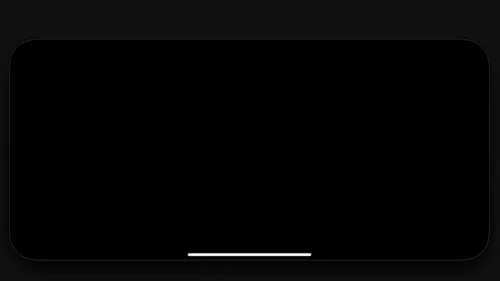
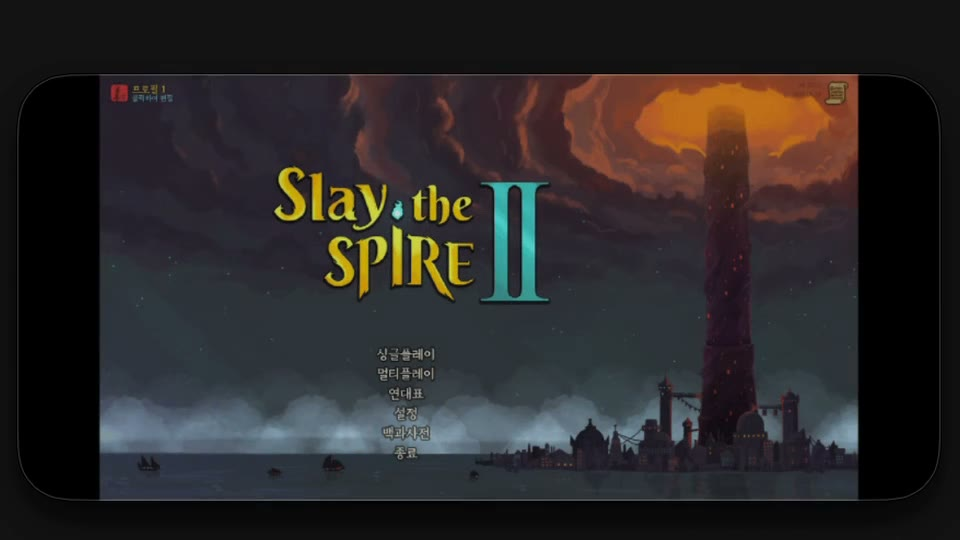
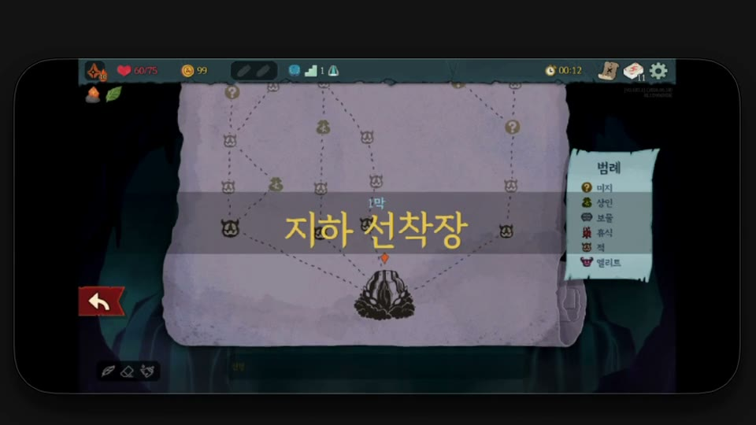
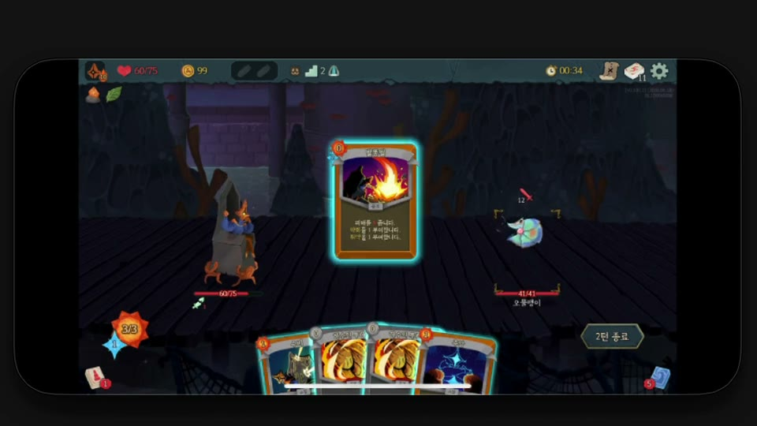
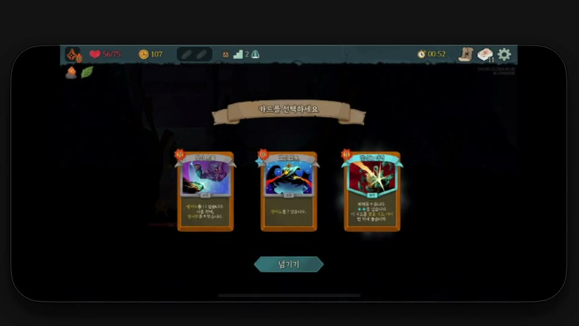

# StS2-iOS-Launcher

**Build Slay the Spire 2 as a native iPhone app from your own Steam copy.** Not streaming: the game runs on
the phone, offline, with Steam Cloud saves shared with your PC.

[한국어 README](README.ko.md)

<p align="center">
  <a href="docs/media/gameplay.mp4"></a>
</p>
<p align="center"><sub>Running on an iPhone 12, captured through iPhone Mirroring.
<a href="docs/media/gameplay.mp4">Full clip (50 s)</a>: launch, character select, map and the first fight.</sub></p>

| | |
|:---:|:---:|
|  |  |
| Main menu | Map |
|  |  |
| Combat | Card reward |

> **Read this first.**
> This repository contains **no part of Slay the Spire 2**: no game code, assets, audio or packs. It contains
> only original build tooling. The tools work on the copy of the game **you bought on Steam**, on your own Mac,
> to put it on your own iPhone. The screenshots and clip in `docs/media` are recordings of the author's own play.
> - Unofficial. Not affiliated with, endorsed or supported by Mega Crit or Valve. Do not contact them about it.
> - **Never share the app or .ipa you build.** It contains Mega Crit's game.
> - Use at your own risk: no warranty (see [LICENSE](LICENSE)). Keep backups of your saves.
> - Rights holders: open an issue and the project will respond promptly.
>
> The legal structure follows the Android launcher [Ekyso/StS2-Launcher](https://github.com/Ekyso/StS2-Launcher).

## What you get

- The full game on iPhone: OpenGL ES 3 (Compatibility) renderer, FMOD audio, both landscape orientations. Touch
  works through Godot's standard touch-to-mouse emulation (tap = click, drag = drag).
- **Automatic Steam Cloud saves.** Continue a run from your PC on the phone and back. The phone pulls before
  the game loads its saves and pushes when you leave the app.
- Runs on a 4 GB iPhone 12: about 650 MB in the menu and 780 MB peak in combat, against a 2 GB app limit.
- **Multiplayer (optional)** with Steam friends through your own PC as a relay, with no server.

## How it works

iOS forbids JIT compilation, so the Android approach (download at runtime, patch with Harmony) cannot work.
Everything is done ahead of time on a Mac:

```
your Steam install ─┬─ game assemblies ──► cecilpatch (build-time IL edits) ──► Godot iOS export (NativeAOT) ─┐
                    └─ game pack (.pck) ──► ASTC textures + iOS settings + shader fix ─────────────────────────┴─► signed app ─► iPhone
```

- **Assembly patches** (`tools/cecilpatch`): iOS has no Steam client, so the game's Steam platform init is
  replaced with a local one. The patches also add the cloud-sync hook and make "Quit" end the app. Nothing is
  patched at run time.
- **Game pack** (`tools/pck/build_pck.py`): desktop textures (S3TC/BPTC) are re-encoded to ASTC so the
  iPhone GPU can read them. The renderer switches to Compatibility (GLES3), because Forward+'s pipeline cache
  alone exceeds the memory limit. Frame pacing drops to 30 fps, and one shader with out-of-bounds array reads is
  fixed; Apple's GPU faults on those reads.
- **Native extensions** (`tools/build_natives.sh`): the game's FMOD and Spine GDExtensions are rebuilt for
  iOS from their official sources.

Details and measurements: [docs/architecture.md](docs/architecture.md),
[docs/in-app-sync-design.md](docs/in-app-sync-design.md).

## Requirements

- A Mac with Apple silicon, **Xcode** (not just the Command Line Tools), `brew install scons dotnet protobuf`
- **Godot 4.5.1 .NET** editor and its export templates (godotengine.org, "4.5.1-stable mono")
- **Slay the Spire 2 on Steam**, installed on that Mac
- **FMOD Engine for iOS**: free download from [fmod.com](https://www.fmod.com/download) after registering. You
  accept FMOD's license; it is not redistributed here.
- An iPhone and an Apple ID for signing. A free Apple ID works, but the app must be
  re-signed every 7 days. A paid developer account lasts a year.

Tested on iPhone 12 with iOS 18. Other iPhones should work; iPads and older iOS versions are untested.

## Setup

```bash
git clone https://github.com/<you>/StS2-iOS-Launcher && cd StS2-iOS-Launcher
make config        # creates config.mk: fill in your paths, Apple team ID, signing identity, bundle ID, device
make natives       # once: FMOD + Spine for iOS (~10 min)
make build         # assemblies, textures (~10 min the first time), pack, export (~10 min), sign
make install       # install on the phone (connected by cable or on the same Wi-Fi)
```

Then, once, for cloud saves:

```bash
make login         # scan the QR code with the Steam mobile app
make provision     # copies that login to the phone app
```

The first time you open the app, iOS asks you to trust your developer certificate: Settings > General > VPN &
Device Management.

`make help` lists every target. All personal values live in `config.mk`, which is git-ignored.

### Staying signed

With a free Apple ID the signature expires after 7 days and the app will not open. Run `make resign`, which
keeps your saves, or install through [AltStore](https://altstore.io) with `make ipa`. AltStore re-signs in the
background whenever the phone and your Mac share a network.

### Game updates

The phone runs the game version you built. After Steam updates the game, run `make build install` again.
Only textures that changed are re-encoded. **Use the same game branch (public or beta) on every device you
sync.** An older version drops content it does not know when it loads a save. The sync refuses to upload such a
save over a newer one, but play is smoother when the versions match.

## Saves and Steam Cloud

- On launch, the phone brings the profile, progress and current run up to date **before the game reads them**.
  It gives up after 8 seconds without network and starts with the saves on the phone.
- When you leave the app, it uploads what changed.
- Each file is compared with the version both sides last agreed on. A change on only one side wins.
  Changes on both sides are compared by progress, and the losing copy is kept in `save-backups/` inside the app.
- A run you finish on one device disappears on the other. Run history follows the game's own cloud limit: the
  newest 100 runs are shared, and older ones stay on each device.
- The Steam login is a refresh token stored in the app. You can revoke it any time from your Steam account's
  authorized devices (Steam Guard settings), where it shows as `sts2ios`.

The phone talks to Steam with a small custom client (`syncmgr/SteamCloudClient.cs`) that only reads and writes
this game's cloud files. It is unofficial. Valve could change or block it, and using third-party clients is at
your own risk under the Steam Subscriber Agreement.

No cable needed day to day. `make sync-pull` and `make sync-push` remain as desktop fallbacks.

## Multiplayer (optional)

An iPhone has no Steam client. Your PC runs a patched copy of your own game as a bridge: friends join your
Steam lobby as usual, and the phone connects to the bridge over UDP. There is no project server. Set `MP=1` in
`config.mk`, then `make bridge-setup`, `make build install`, and `make bridge-run` each session. See
[docs/architecture.md](docs/architecture.md) and [docs/reachability.md](docs/reachability.md). Everyone needs the
same game version.

## Known limits

- **Signing**: free Apple IDs expire after 7 days (see above). Apple allows 3 sideloaded apps per free ID.
- **Graphics**: the Compatibility renderer has no 2D MSAA/FXAA and no particle sub-emitters. The first time an
  effect appears it can stutter while its shader compiles; it is cached afterwards.
- **Heat**: long fights warm the phone ("Fair" thermal state after 4+ minutes). 30 fps is the default; the
  in-game frame limit setting still works.
- **Touch**: plain touch-to-mouse emulation, so there is no right click and the game shows 16:9 with side bars.
- Achievements and Steam overlay features are unavailable on the phone.

## Troubleshooting

| Symptom | Fix |
|---|---|
| App does not open, "untrusted developer" | Settings > General > VPN & Device Management > trust |
| App does not open after a week | `make resign` (free Apple ID) |
| Saves not syncing | `make logs` copies the app's `sync_log.txt` to your Mac; `make provision` again if it says the login was rejected |
| Black screen after export | Only `--export-release` builds work on device; use `make export`, not the editor |
| `make natives` fails finding the SDK | Install Xcode; the Command Line Tools alone have no iOS SDK |

## Repository layout

| Path | What |
|---|---|
| `Makefile`, `config.mk.example` | the whole workflow |
| `tools/cecilpatch/` | build-time assembly patcher (Mono.Cecil) |
| `tools/pck/` | iOS game pack builder and ASTC transcoder |
| `tools/build_natives.sh`, `patches/` | FMOD and Spine iOS builds |
| `tools/assemble.sh` | app bundle assembly and signing |
| `syncmgr/` | in-app sync and iOS lifecycle; `syncmgr/tests/` offline tests (`make test`) |
| `tools/stssync/` | desktop Steam login and save sync |
| `bridge/` | multiplayer PC bridge |
| `gameapp/` | Godot project used for the export (no game code; assemblies are copied in by `make libs`) |
| `docs/` | design notes, measurements, [ROADMAP](docs/ROADMAP.md) |

## Credits

[Ekyso/StS2-Launcher](https://github.com/Ekyso/StS2-Launcher) (Android launcher; legal structure and patch
reference), [SocialHummingbird/StS2-Launcher-Overhaul](https://github.com/SocialHummingbird/StS2-Launcher-Overhaul)
(Steam Cloud reference), [Godot](https://godotengine.org), [FMOD](https://www.fmod.com),
[Spine](https://esotericsoftware.com), [fmod-gdextension](https://github.com/utopia-rise/fmod-gdextension),
[SteamDatabase/Protobufs](https://github.com/SteamDatabase/Protobufs). Third-party licenses:
[THIRD_PARTY_NOTICES.md](THIRD_PARTY_NOTICES.md).

## License

MIT for this repository's code ([LICENSE](LICENSE)). Slay the Spire 2 belongs to Mega Crit.
